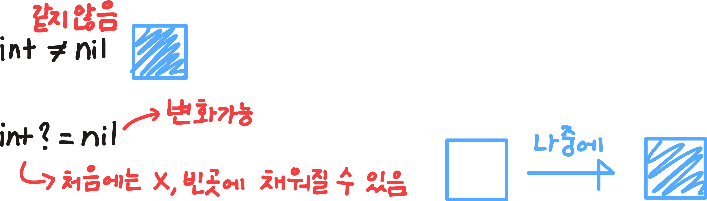
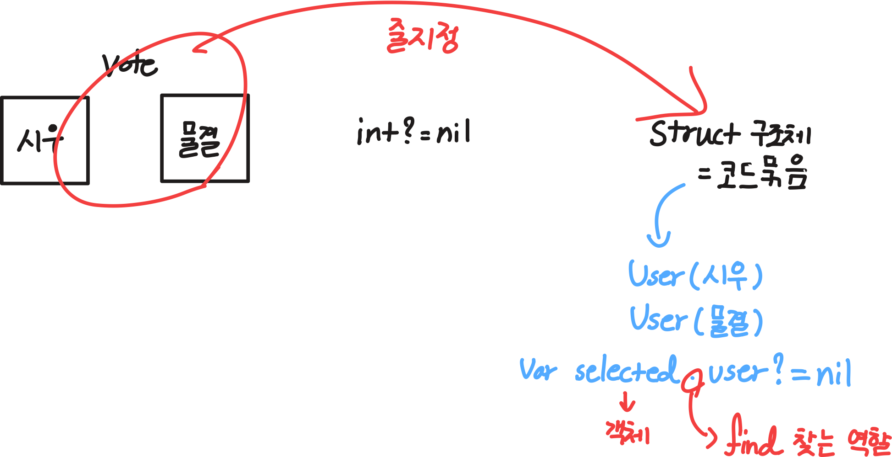
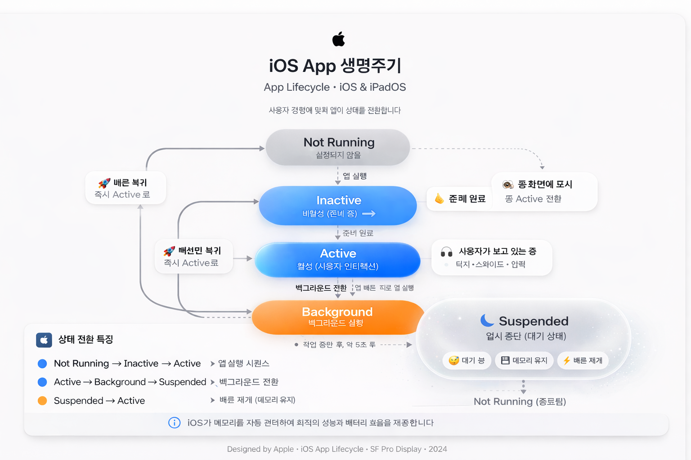

**<nil과 int?>**

-
*
int = 무조건 값이 있어야 됨
*
int? = 값이 있을 수도 있고 없을 수도 있음(Int?는 값 있음 - 없음(nil) 으로 바뀔 수 있음)
-옵셔널 생성가능하고 서버통신 때 주로 씀
 
*
Int는 절대 nil이 될 수 없고, Int?는 nil이 될 수 있음
 

 

**<문법을 배워야하는 이유>**

-
로직(어떻게 순서로 작동할지 정하는 과정)을 하기 위해서임

**<프로그래밍 문법>**

-
*
struct = 상태를 저장하는 틀
*
selected = 사용자가 어떤 항목을 선택했는지 저장하는 변수 이름
보통 의미 = 선택된 번호

**<'struct 안에서 Int?를 사용한 선택 상태'>**

-
*
Vote라는 데이터 묶음을 만듬
-정보를 저장하기위해서
*
Int? = 선택값은 숫자인데 아직 선택 안했을 수도 있음
*
selected 는 선택 상태를 저장하는 값인데 처음에는 아무것도 선택 안했으니까 nil, 선택하면 숫자가 들어감
 

 

*
전체 문장으로 예시 풀면
struct Vote { var selected: Int? = nil }
해석 =  Vote 구조체 안에 selected라는 변수가 있고 선택된 번호를 저장하는데 선택 안했을 수도 있어서 Int? 로 만들고 처음 값은 nil이다 상태 변화 느낌

**<앱 생명주기>**

-
*
앱 생명주기 = 앱이 켜지고 꺼질 때까지에 상태 변화 과정
즉, 앱도 살아있는 것처럼 상태가 계속 바뀜
*
전체적인 흐름
 *
 Not Running
 *
 Inactive
 *
 Active
 *
 Background
 *
 Suspended
중요한 이유
앱은 상황이나 상태에 따라 해야 할 일이 다름( 앱이 처음 켜질 때, 다른 앱을 보러 잠깐 나갈 때 )
 
*
Not Running
앱이 꺼져있는 상태
아직 실행 안됨, 또는 완전히 종료됨
*
Inactive
앱 켜졌는데
아직 사용 못하는 상태 
ex)앱 켜지는 순간 전화 왔을 때 잠깐 멈춤
*
Active 
사용자가 실제로 앱 사용 중
ex)버튼 누르고, 화면 보고, 입력하는 상태, 제일 많이 보는 상태
*
Background
앱이 화면에는 안보이는데 뒤에서 살아있음, 
일부 작업을 잠깐 수행할 수 있는 상태로 
이후에 Suspended 상태로 전환 가능
 *
 일부 작업 = 모든 작업이 아니라 제한된 몇 개 작업만 가능하다는 뜻
 -iOS가 배터리 절약하려고 필요한 작업만 잠깐 허용함
ex)다운로드 ⬇️, 위치 확인 📍
즉, Background 상태에서는 모든 기능 X → 꼭 필요한 일부만 O

*
Suspended
앱이 잠들어 있는 상태로 대기중임
앱이 화면에는 안 보이고, 아무 일도 안 하고 멈춰있음
하지만 완전히 꺼진 건 아님 필요할 때 빠르게 다시 켜지려고 메모리에 남아있음
ex)카톡 하다가 홈버튼 누름, 음악앱 계속 재생됨

